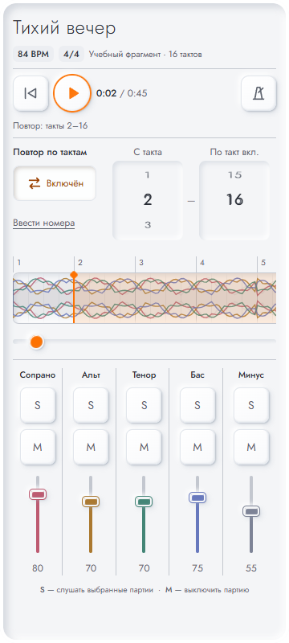
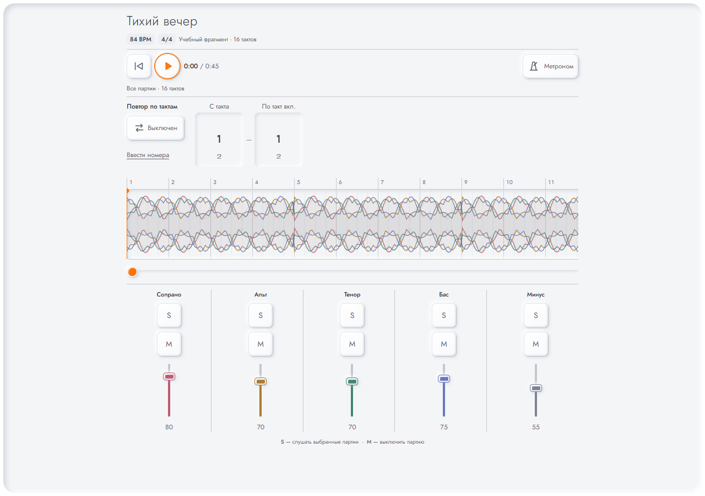

# Неоморфизм и диапазон повтора — 30 октября 2026

Проверена реализация `791dbae` для PR #53 (Issues #52 и #45).
Все снимки сделаны на вымышленных Storybook-данных, без пользовательского аудио.

В отдельном Edge на Windows исходная команда `npm run test:stories` завершилась
успешно: **63/63** истории вместе с play, без пропусков и повторов упавших случаев.
До исправлений обновлённые `WheelRange` и `LongScoreRange` воспроизвели ошибки;
после исправлений обе истории прошли в полном прогоне.

| Размер | Результат |
| --- | --- |
| 320 × 640 | Нет горизонтального переполнения; подпись «По такт вкл.» помещается |
| 360 × 800 | Нет горизонтального переполнения; включённый повтор и ошибка ввода просмотрены |
| 800 × 360 | Нет горизонтального переполнения; управление доступно с вертикальной прокруткой |
| 1280 × 900 | Нет горизонтального переполнения; компактная группа диапазона просмотрена |

Нативными событиями клавиатуры проверены ArrowUp (увеличение начала до 2) и End
(конец 16). Повтор 2–16 включается; выключение сохраняет границы. В ручном вводе
значение 17 показывает ошибку и отключает кнопку повтора. `LongScoreRange`
проверяет сразу видимые поля для 1001 такта, последний такт, ошибку и исправление.

Независимые повторные ревью Standards и Spec закрыли все три замечания:
направление стрелок spinbutton, неограниченное создание вариантов барабана и
отсутствие видимого пояснения включительного конца.

Это локальная проверка интерфейса и эмуляция размеров. Она не заменяет физические
iOS/Android, оценку слышимого звука и отдельные runtime/CI проверки в PR.
Порог 1000 ограничивает только варианты барабанов: длинные песни сохраняют весь
диапазон через числовой ввод. Отрисовка подписей таймлайна не оптимизировалась.

## Мобильный экран, повтор включён

## Десктоп, повтор выключен

